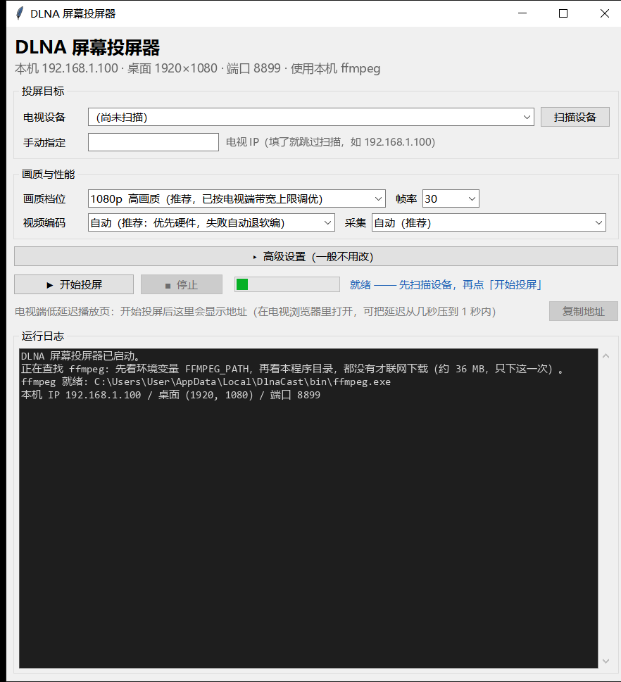

# DLNA 桌面投屏器（Windows）

[English](README.en.md) | **简体中文**

把 Windows 桌面**实时投到局域网智能电视**。电视端零安装、不依赖 Miracast、不需要 HDMI 线或电视盒子。

程序用 ffmpeg 采集屏幕与系统声音 → H.264 编码 → MPEG-TS 封装 → 由内置 HTTP 服务输出 → 通过 UPnP `AVTransport` 让电视主动拉流播放。

**适用场景**：投 PPT / 网页 / 视频给客厅电视；旧电脑当临时媒体中心；投屏打游戏（延迟约 1–2.5 秒，不适合竞技类）。



---

## 目录

- [特性](#特性)
- [运行要求](#运行要求)
- [快速开始](#快速开始)
- [画质档位](#画质档位)
- [电视端播放：两条通路](#电视端播放两条通路)
- [工作原理](#工作原理)
- [参数速查](#参数速查)
- [实测数据与已知限制](#实测数据与已知限制)
- [常见问题](#常见问题)
- [项目结构](#项目结构)
- [第三方组件](#第三方组件)
- [许可](#许可)

---

## 特性

| 能力 | 说明 |
|---|---|
| 零安装 | 电视端不需要装任何 App，只要支持 DLNA / UPnP 即可 |
| 双形态 | 同一个 exe：双击打开图形界面，带参数运行则是完整命令行工具 |
| 声音跟随 | 默认**静音本机**，声音只从电视出；退出时自动恢复 |
| 声音来源 | WASAPI 环回捕获系统声音，**不依赖「立体声混音」**（该项常被系统禁用） |
| 硬件编码 | 优先 MediaFoundation（`h264_mf`），CPU 几乎不占；失败自动回退 libx264 |
| 免配 ffmpeg | 本机没有 ffmpeg 时，自动从 GitHub 下载（只取 zip 内需要的那一个文件，省约 67% 流量） |
| 端口自愈 | 首选端口被系统保留时自动往后找可用端口，投流地址同步更新，不会启动失败 |
| 代理免手动 | 代理开 TUN 抢走路由时自动改用物理网卡；组播被拦还会扫网段兜底 |
| 低延迟通路 | 电视浏览器可直接开 `/tv` 播裸 MPEG-TS，缓冲深度由页面控制而非电视厂商决定 |
| 可诊断 | 内置 OSD 实时显示帧率/码率/延迟；`--clock` 提供毫秒时钟页用于实测端到端延迟 |

---

## 运行要求

**Windows 10 / 11**（开发与实测环境：Win10 22H2 + 4 核 8 线程笔记本 + 5 GHz 无线网卡）。

- **电视与电脑必须在同一局域网**。推荐 5 GHz Wi-Fi 或有线；2.4 GHz 通常撑不住 1080p 码率。
- **ffmpeg**：不需要手动准备。查找顺序见下，最后一步会自动下载。
- **Python 3.8+**：仅源码运行时需要。

ffmpeg 查找顺序（定义在 `screen-cast.py::find_ffmpeg()`，全项目唯一一处）：

```
FFMPEG_PATH 环境变量
  → exe / 脚本 同目录下的 ffmpeg.exe
  → %LOCALAPPDATA%\DlnaCast\bin\ffmpeg.exe
  → 常见安装路径（D:\ffmpeg 等）
  → PATH
  → 自动从 GitHub 下载到 exe 同目录
```

想强制忽略本机已装的版本、重新下载：

```bat
set DLNACAST_FORCE_DOWNLOAD=1
```

想换下载源（例如镜像）：

```bat
set DLNACAST_FFMPEG_URL=https://example.com/ffmpeg-release-essentials.zip
```

---

## 快速开始

### 方式一：打包成 exe

```bat
build_exe.bat
```

产物为 `dist\DLNA投屏器.exe`（约 12.7 MB）。**exe 本身不含 ffmpeg** —— 运行时按上面的顺序查找，找不到才下载。这样双击启动不必每次向磁盘写 231 MB，冷启动明显更快。

- **出英文版**：`build_exe.bat --lang en` → 产物 `dist\DLNACast.exe`，界面默认英文
- 用自定义 ffmpeg 打包：`build_exe.bat --ffmpeg D:\ffmpeg\ffmpeg.exe`
- 想要「一个文件包揽全部」的旧方案（exe 约 69 MB）：`build_exe.bat --embed-ffmpeg`

两个版本除语言外完全一致。英文版用户仍可用 `--lang zh` 或 `DLNACAST_LANG=zh` 在运行时切回中文。

### 方式二：直接跑源码

```bat
pip install pyinstaller      # 仅打包时需要；直接运行不需要任何第三方库
python screen-cast.py        # 交互式菜单：扫描设备 → 选画质 → 开始
```

常用组合：

```bat
python screen-cast.py --list                       :: 只列设备，不投屏
python screen-cast.py --ip 192.168.1.100           :: 指定电视 IP，跳过扫描
python screen-cast.py --quality 1080hq --fps 30    :: 推荐画质组合
python screen-cast.py --low-latency                :: 流畅优先预设
python screen-cast.py --no-push                    :: 只起流服务，本机自测
python screen-cast.py --unmute                     :: 程序被强杀后本机没声音时用
```

任意命令加 `--lang en` 即可改用英文输出。

---

## 画质档位

码率上限不是拍脑袋定的，而是**由电视端实际能持续消费的速率倒推**（见[实测数据](#实测数据与已知限制)）。

| 档位 | 目标高度 | 目标码率 | 峰值码率 | 说明 |
|---|---|---|---|---|
| `540` | 540 | 1200 | 1400 | 流畅（弱网 / 弱 CPU） |
| `720` | 720 | 2500 | 2900 | 标清（默认） |
| `1080` | 1080 | 4500 | 5200 | 高清 |
| **`1080hq`** | 1080 | 5500 | 6500 | **推荐**，按电视端带宽上限调优 |
| `1440` | 1440 | 14000 | 17000 | 2K，需屏幕本身 ≥1440p |
| `2160` | 2160 | 28000 | 34000 | 4K，需 4K 屏幕 |

**默认禁止上采样**：1080p 屏幕选 2K/4K 档会自动降级到 1080p。放大不会变清晰，只会把码率推高、挤爆局域网。确实需要放大时加 `--allow-upscale`。

**想提高画质就选 `1080hq`**（同分辨率提高码率），而不是选更高分辨率档。

---

## 电视端播放：两条通路

### 通路 A：DLNA 推送（默认，最稳）

程序把电视当 UPnP 渲染器，用 `SetAVTransportURI` + `Play` 让它主动拉流。

- **优点**：兼容性最好，绝大多数智能电视都支持；电视遥控器直接控制播放/暂停。
- **缺点**：端到端延迟 1–3 秒。**这段延迟的主体是电视自带播放器的缓冲深度，本机侧任何调参都动不了它。**

### 通路 B：电视浏览器播 `/tv`（低延迟，实验性）

程序启动时会打印形如 `http://<本机IP>:8899/tv` 的地址。用**电视自带的浏览器**打开它：

- 用 [mpegts.js](https://github.com/xqq/mpegts.js) 在页面里直接播裸 MPEG-TS，**缓冲深度由页面控制而非电视厂商决定**。
- 三档缓冲可现场切换：0.5 s / **1.0 s（默认）** / 2.0 s。
- 页面提供 `/clock` 毫秒时钟页，可与电脑同框拍照实测端到端延迟。

**现状说明（如实）**：这条通路对浏览器能力有要求，部分电视浏览器上会报 `NetworkError · Exception`。原因是该构建版 mpegts.js 只带 4 条取流通道，而它们在「无 `Content-Length` 的无限长 HTTP/1.0 响应」下都可能失效：

| 通道 | 依赖 | 常见电视浏览器 |
|---|---|---|
| `fetch-stream-loader` | `window.fetch` + `ReadableStream` | 部分机型无 `fetch` |
| `xhr-moz-chunked-loader` | `moz-chunked-arraybuffer`（Firefox 专有） | 基本不可用 |
| `xhr-range-loader` | XHR + Range 分段 | 落到这里，但**与无限长响应不兼容** |
| `websocket-loader` | `ws://` 地址 | 可用（需服务端支持） |

因此仓库内提供了 `tools/_tv_preview.py`（预览服务，见[项目结构](#项目结构)）：它在不改动正式服务的前提下，把页面与 `/live.ts` 反代到另一端口，并额外实现了 `/live-chunked`（HTTP/1.1 + chunked）、`/probe`（电视浏览器能力探测页）与 `/ws-live`（WebSocket 推流）。`/ws-live` 已本机实测可用（3 秒 146 帧 / 1.11 MB / 2.94 Mbps，帧首 `0x47` 为合法 TS 同步字节）。

**若电视浏览器不可用**，用 **VLC for Android** 打开投流地址（以 `/live.ts` 结尾），并把「网络缓冲」调到 300 毫秒。

---

## 工作原理

```
屏幕 ──ffmpeg/gdigrab│ddagrab──┐
                              ├─→ H.264 (libx264 | h264_mf) ─→ MPEG-TS
扬声器 ─WASAPI loopback───────┘         │
                                        ↓
                            内置 HTTP 服务 (video/mp2t)
                                        │
                      ┌─────────────────┴─────────────────┐
                      ↓                                   ↓
        UPnP AVTransport 推送                   电视浏览器 /tv
        （电视主动拉流，延迟 1~3 s）            （页面控缓冲，延迟更低）
```

关键设计：

1. **音频不依赖「立体声混音」**。该设备常被系统禁用，且 `MMDevices` 注册表归 `NT AUTHORITY\SYSTEM` 所有。改用 `ctypes` 直接调用 WASAPI 环回，零依赖、零系统改动。音频以 32-bit float PCM 经管道送入 ffmpeg。
2. **声音转移不切设备、不改注册表**。用 `IAudioEndpointVolume::SetMute`，它作用在硬件输出层、**位于环回采样点之后**，因此静音本机后环回仍能取到完全相同的音频数据。恢复保护三层：`finally` → `atexit` → `SetConsoleCtrlHandler`。
3. **裁剪只能落在 IDR 关键帧起始包上**。实测仅 **0.22%** 的包位置是关键帧起始包，只按 188 字节边界对齐时 99.8% 概率落在 GOP 中间，客户端会拿到孤立 P 帧并花屏到下一个关键帧。代码同时向前/向后搜索关键帧，找不到就**本次不裁**（而非退化截断）。
4. **发送节流决定延迟**。`--lead-ms`（默认 800 ms）限制服务端允许超前实时的毫秒数，直接决定电视端缓冲深度，避免延迟随播放时长无限累积。
5. **交织间隔收紧到 100 ms**。ffmpeg 默认 10 秒，会让音视频包在 TS 里相距过远；一旦按字节丢弃积压，两者被丢掉的时间跨度不一致，累积起来就是音画不同步。

---

## 参数速查

完整列表见 `python screen-cast.py --help`。

| 参数 | 默认 | 说明 |
|---|---|---|
| `--quality` | `720` | 画质档位：540/720/1080/1080hq/1440/2160 |
| `--fps` | `30` | 帧率。gdigrab 1080p 实测上限 30；更高需 `--capture ddagrab` |
| `--encoder` | `auto` | `auto` / `mf`（硬件）/ `x264`（软编） |
| `--capture` | `auto` | `auto` / `gdigrab` / `ddagrab`（Desktop Duplication，抓帧更快） |
| `--latency-ms` | `300` | 本机流缓冲水位，本机侧延迟的唯一来源 |
| `--lead-ms` | `800` | 发送节流，决定电视端缓冲深度 |
| `--gop-ms` | `500` | 关键帧间隔，越小追帧恢复越快、码率越高 |
| `--buffer` | `384` | 流缓冲上限（KB） |
| `--bitrate` | `0` | 手动码率（kbps），覆盖档位默认值 |
| `--audio` | `loopback` | `loopback` / `none` / `dshow:<设备名>` |
| `--keep-local-audio` | 关 | 保留电脑本地声音（默认静音本机） |
| `--low-latency` | 关 | 流畅优先预设：x264 + 250 ms 缓冲 + 400 ms 关键帧 + 30 fps |
| `--lang` | `zh` | 界面语言：`zh` / `en` |
| `--clock` | 关 | 打开毫秒时钟页，用于实测端到端延迟 |
| `--no-osd` | 关 | 关闭画面右上角的信息显示 |
| `--push-retry` | `2` | 电视未接入时的自动重推次数 |
| `--push-wait` | `18` | 每次推送后等待电视接入的秒数 |
| `--no-push` | 关 | 只起流服务，不推给电视（本机自测） |

---

## 实测数据与已知限制

以下均为本机（2015 年款 4 核 8 线程笔记本 / Win10 / 5 GHz Wi-Fi）实测值，非推断。

### 链路吞吐是硬约束

放剧集（1080p30）时，编码产出 **7956 kbps**，而电视端只能持续收下 **7039 kbps** —— 缺口 11.5% 全部转为持续丢弃 → 时间轴跳跃 → **卡顿**。

因此各档峰值码率都留在 **6500 kbps 以内**（约 18% 余量）。日志中出现「已丢弃」持续增长且占比 >5% 时会打印「★ 链路吞吐不足」告警。微调入口：`--bitrate`（峰值自动 ×1.18）。

### 帧率上限

- **gdigrab 1080p 采集上限为 30 fps**（请求 60 也只出 30），瓶颈在 BitBlt 耗时。
- **ddagrab 实测可达 57.2 fps**，是突破 30 上限的唯一途径。
- **`ddagrab` + `h264_mf` 组合会让 ffmpeg 段错误（exit=139）**，代码中有三层防护：组合过滤 / 自动改 x264 / 四组合回退。
- `h264_mf` 输出 Constrained Baseline、L4.0、无 B 帧，且不实现 `-profile:v`；相比 x264 少约 7% 帧。
- `ddagrab` 的 `output_idx=0` 只抓主显示器；`gdigrab` 抓虚拟桌面并集。

### 编码器实测

| 编码器 | 结果 |
|---|---|
| Intel QSV | **不可用** —— 初始化失败 `-22 Invalid argument` |
| NVENC | **不可用** —— Optimus 限制 |
| `h264_mf` | **首选**，CPU 几乎不占（`-scenario display_remoting` + `-rate_control ld_vbr`） |
| `libx264 veryfast` | 兜底。实测 1080p30 有 **3.09 倍**实时余量，折算约 3.2 个核 |

> `ultrafast` 已被替换为 `veryfast`：同为最差压缩档，ultrafast 要多花约 10% 码率，而码率在本场景是稀缺资源。

### 端到端延迟

| 环节 | 时间 |
|---|---|
| 本机采集 + 编码 | 约 10 ms 量级（硬件编码） |
| 本机流缓冲 | 由 `--latency-ms` 控制，默认 300 ms |
| **电视端播放器缓冲** | **1–3 秒，本程序无法控制** |

**总延迟实测约 1–2.5 秒。** 本侧（采集编码 + 缓冲）已压到约 50 ms + 0–2 ms，剩余大头是电视厂商播放器的缓冲深度。若需更低延迟，走[通路 B](#通路-b电视浏览器播-tv低延迟实验性)。

### 其他注意事项

- **电视开机有约 15 秒启动广告**，期间播放器可能「只连流不消费」，数据全堆在电视内存里，广告结束后才开始播——表现为延迟异常大。程序默认用 `Stop + 重推` 强制电视清空缓冲。
- **系统完全静音时 WASAPI 环回不产出任何数据**（实测 3 秒 0 帧），程序会按实时速率补静音 PCM，否则 ffmpeg 会死等音频输入、连视频一起卡死。
- 旧方案（Miracast / AirPlay / Chromecast）在本机电视上均**不可用**：电视无 WFD 广播；AirPlay 仅音频且 `SETUP` 返回 `604 Internal Audio Server Error`；Chromecast 的 8009 端口未开放。DLNA 是唯一通路。

---

## 常见问题

**投屏没声音，或电脑和电视同时响**
默认行为是静音本机。若想两边都响，加 `--keep-local-audio`。若程序被 `taskkill /F` 强杀导致本机被静音，运行 `python screen-cast.py --unmute` 恢复。

**画面卡顿、走走停停**
先看日志有没有「链路吞吐不足」告警。有的话用 `--bitrate 4000` 之类的值压到实测交付速率以下约 15%。再不行把档位降到 `720`。

**画面花屏、绿块**
通常是客户端拿到了 GOP 中间的非关键帧。确认没有第三方程序在抢同一路流；重连一次让程序重新对齐到关键帧。

**延迟越来越大（不是卡顿，是持续落后）**
电视端播放器可能以低于 1.0 倍速消耗缓冲。用 `--clock` 打开时钟页，隔 30 秒拍两张同框照对比即可判定。

**启动报 `WinError 10013`（以一种访问权限不允许的方式做了一个访问套接字的尝试）**
这**不是端口冲突**（那是 `10048`），而是端口落在 Windows 的**保留区间**里。Hyper-V / WSL2 / Docker 会动态保留成段端口（实测本机 8880–9079 整段被占），且**每次重启都可能变** —— 所以「以前一直好好的」和「现在报错」并不矛盾。这种情况加防火墙规则、用管理员运行都无效。

程序会**自动往后找可用端口**（候选 9080 → 9081 → … → 18080 → …，全不行则交给系统分配），并把投流地址、`/tv` 播放页、ffplay 提示一并改过来，日志里会打印 `[端口] 首选 8899 被系统保留，已自动改用 9080`。**以程序显示的地址为准，不要把 8899 记死。**
确实想固定端口：`--port 9000`。

**开着代理 / VPN（TUN 模式）就扫不到电视**
代理的 TUN 会接管默认路由，而 DLNA 依赖 SSDP 组播 —— 组播从虚拟网卡发出去会被直接吞掉。程序内置三层应对：

1. 识别虚拟网卡，改用物理网卡的本机地址发包；
2. 组播无响应时，自动对本 /24 网段逐个发单播 `M-SEARCH`（TUN 不影响网段内单播）；
3. 直接在「电视 IP」框里填电视 IP，填了就跳过扫描。

若三层都无效，最彻底的解法是把局域网加进代理的**绕过列表**（Clash / Mihomo 的 `tun.route-exclude-address` 填 `192.168.1.0/24` 之类；其它客户端打开「绕过局域网 / Bypass LAN」），或临时切到「系统代理 / PAC」模式。

---

## 项目结构

```
screen-cast.py          核心：设备发现 / 采集编码 / HTTP 流服务 / UPnP 推送（也是命令行入口）
cast_gui.py             图形界面；同时是 PyInstaller 打包入口（无参数 → GUI，有参数 → 命令行）
i18n.py                 中英翻译表（以中文原文为 key）
ffmpeg_fetch.py         免配置获取 ffmpeg：查找 + GitHub 分段下载 + CRC 校验 + 能力检查
ffpayload.py            「内嵌 ffmpeg」旧方案的追加式载荷（仅 --embed-ffmpeg 时使用）
build_exe.py            一键打包（PyInstaller + 校验）；--lang en 出英文版
screen-cast.spec        PyInstaller 配置
build_exe.bat           打包入口（纯 ASCII，避免 GBK 乱码）
screen-cast.bat         命令行版启动器
dlna-probe.py           独立诊断工具：扫描 UPnP 设备 + 记录电视发出的每个 HTTP 请求
dlna-probe.bat          上述工具的启动器
tcl-cast.ps1            v1.0 早期探索版（PowerShell），已被 screen-cast.py 取代，保留供参考
cast.bat                早期探索版启动器

static/
  tv.html               电视浏览器播放页（mpegts.js，三档缓冲可切）
  probe.html            电视浏览器能力探测页（6 节，约 18 秒跑完）
  mpegts.js             mpegts.js（本地托管 —— 电视不一定能连外网，但一定能连局域网）

assets/
  app.ico               应用图标
  version_info.txt      Windows 版本信息（构建时生成）

tools/                  实测与诊断脚本（非运行必需）
  _diag_fps.py          采集帧率上限实测
  _diag_grab.py         采集后端对比
  _diag_burst.py        突发吞吐
  _diag_e2e.py          端到端链路诊断
  _diag_sock.py         原始 socket 测接收节奏
  _fetch_probe.py       下载源解析 / zip 中央目录定位
  _fetch_small.py       用小成员验证解压 + CRC 链路
  _fetch_bench.py       单/多连接吞吐对比
  _fetch_e2e.py         端到端下载（abort N 中止 → finish 验续传）
  _fetch_test.py        查找与下载两条路径测试
  _startup_time.py      A/B 测「双击 → 窗口出现」耗时
  _gui_smoke.py         界面冒烟测试
  _gui_flow.py          界面全流程测试
  _gui_dl.py            界面下载接线测试（替身）
  _tv_probe.py          直连 /live.ts 采样，验 TS 结构
  _tv_preview.py        电视端页面预览服务（静态资源读磁盘 + 反代 + WebSocket 推流）
  _ws_live_check.py     WebSocket 客户端：握手 → 读帧 → 校验 0x47
  _winshot.py           按窗口句柄截图（避开遮挡）
  _exe_test.py          真机运行 exe 并截图
  make_icon.py          代码绘制应用图标

docs/
  screenshot.png        界面截图
```

### 诊断工具的两个坑

1. **不要用 `http.client` / `urllib.response.read(65536)` 测到达节奏** —— 它会**阻塞读满** 65536 字节，把平滑流伪装成周期性停顿。必须用原始 socket + 小 `recv()`。
2. **不要把 `--no-push` 自测的帧率当成电视端帧率** —— 电视端还有自己的解码与显示链路。

---

## 第三方组件

| 组件 | 用途 | 许可 |
|---|---|---|
| [ffmpeg](https://ffmpeg.org/) | 采集、编码、封装 | LGPL / GPL（取决于构建；本程序不内嵌，运行时获取） |
| [mpegts.js](https://github.com/xqq/mpegts.js) | 电视浏览器播放 MPEG-TS | Apache-2.0 |

---

## 许可

[MIT](LICENSE)
